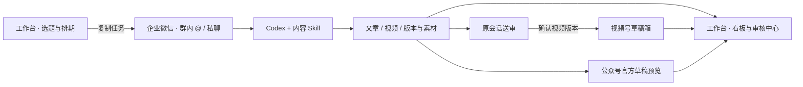

# 自媒体运营管理工作台

**从选题、文章和视频制作，到审核、平台草稿，集中管理微信公众号与视频号的内容运营。**

项目名保留 `wechat-editorial`。企业微信是日常任务入口，Codex 与 Skill 负责制作，工作台负责查看全局进度、版本素材、审核和运营排期。继续支持“一句话发任务”，所有制作进度与成品回到原会话：私聊回本人，群消息回原群。

## 工作台里能做什么

| 模块 | 当前能力 |
|---|---|
| 运营总览 | 内容数量、制作进度、待审核、已有草稿、连接状态 |
| 内容看板 | 搜索与筛选真实任务，查看历史版本、素材、完整标题与简介 |
| 审核中心 | 播放 / 下载 MP4，打开公众号官方预览，复制对应版本的审核或修改指令 |
| 选题与排期 | 新建选题，记录负责人、日期、目标平台、制作要求，关联已有内容并归档 |
| 账号与连接 | 展示企业微信心跳、执行器状态、公众号检查记录与 TurboPush MCP 配置状态 |

数据来自真实任务目录与回执，首次启动没有演示内容。保存选题后可复制企业微信任务交给机器人制作；排期只作运营计划，不会触发自动发布。审核仍在原企业微信会话完成，页面不代替真实用户确认。



## 打开本地工作台

界面与服务只用 Python 标准库；单独查看工作台不需要安装 Node 依赖、配置密钥或启动机器人。

```bash
git clone https://github.com/hreyulog/wechat-editorial.git
cd wechat-editorial
python3 editorial/workbench/server.py
```

打开 **http://127.0.0.1:8788**。Windows 使用 `python`；已配置 Node / Python 环境时也可 `npm run workbench`。已有制作实例可以单独指定数据目录：

```bash
python3 editorial/workbench/server.py --studio /path/to/wechat-content-studio --bot /path/to/wecom-bot-local
```

选题与排期独立保存在被 Git 忽略的 `editorial/workbench/state/`，不会改动旧实例的 jobs、outbox、审核记录或聊天状态。完整操作见 [工作台说明](docs/WORKBENCH.md)。远程 Linux 可通过 SSH 本地端口转发查看。

## 一句话制作与送审

在指定企业微信群真正 @ 机器人，或由已确认的群成员私聊：

```text
做一期马尔可夫人物视频，沿用切比雪夫的风格，再配一篇公众号文章。
进度 C0001
修改 C0001：开头更直接，保留原配音。
OK C0001-v2
```

机器人立即回复“收到，处理中”，关键阶段持续回报进度；需要选方向或试听确认时先问、等下一条回复。同一会话的补充即时进入当前任务，“停止”中断，“新任务：……”进入队列。

视频先发 **MP4 文件附件、实际视频名、完整简介、目标账号和版本**。你看完确认后才上传对应视频号草稿，并返回实际回执。公众号文章发送真实官方草稿预览。OK 只授权视频草稿上传；公开发表需要另行明确授权，当前流程不自动执行。

视频号作品原生卡片可自动插入文章，前提是取得该作品真实 `export_id` 与账号字段，并经官方读回核验；新作品 ID 的自动获取尚未完整打通，详见 [文章视频组件](docs/ARTICLE-VIDEO.md)。

## 部署完整制作流程

需要 Node.js 22+、Python 3.11+、FFmpeg、中文字体、Codex CLI 和自己的企业微信 Bot 凭证；公众号草稿另需开发接口权限与出口 IP 白名单。

```bash
bash scripts/setup-linux.sh
# 配置 .env，并用运行机器人同一个用户登录 Codex CLI
# 停止旧机器上同一个 Bot 实例，再绑定：
npm run bind
npm run bot
# 另开终端：
npm run workbench
```

详见 [Linux 部署](docs/LINUX.md)。单个 Bot 保持一个长连接实例；启动不会发送样例或补发历史稿件。Linux 执行路径不依赖桌面微信或 codex-weixin 网页服务。TurboPush 是可选 MCP 集成，提供实际 21 个工具，含 `publish_video`；已配置与真实上传结果分别展示。

**已在 Windows 检查新增工作台及已有核心测试；未在 Linux 实机运行验证。** 工作机历史成功记录不替代迁移环境验收。

## 仓库结构与 Skill

| 路径 | 职责 |
|---|---|
| [editorial/workbench](editorial/workbench/server.py) | 本地运营管理界面、真实状态聚合、独立选题排期 |
| [editorial/wecom-bot-local](editorial/wecom-bot-local/bridge.mjs) | 企业微信接入、持久队列、原生 Codex 会话、即时控制与媒体发送 |
| [editorial/wechat-content-studio](editorial/wechat-content-studio/AGENTS.md) | 内容版本、构建、检查、公众号草稿、视频号集成 |
| [wechat-editorial-workflow](wechat-editorial-workflow/SKILL.md) | 运营、制作与审核协作流程 |
| [math-explainer-animation](math-explainer-animation/SKILL.md) | Remotion / SVG 数学知识动画 |
| [st-petersburg-math-documentary](st-petersburg-math-documentary/SKILL.md) | 人物纪录片、中文配音、双语字幕与系列风格 |

制作由对应 Skill 按用户选题进行研究、写稿和渲染。迁移版本保留明确的内容分工，未宣称自动并行多 Agent 调度。文章排版与草稿构造复用固定版本上游子集，来源及授权见 [NOTICE](NOTICE.md)。

## 文档与迁移包

- [工作台启动、数据与使用](docs/WORKBENCH.md)
- [架构、状态与故障处理](docs/WORKFLOW.md)
- [视频审片、确认与草稿上传](docs/VIDEO-REVIEW.md)
- [TurboPush MCP 接入](docs/TURBOPUSH-MCP.md)
- [视频 Skill 与风格](docs/VIDEO-SKILLS.md)

```bash
python3 scripts/export-migration.py --output ./dist
```

从已提交的干净源码生成 tar.gz、ZIP、SHA256 与文件清单。归档只包含 Git 受控源文件，排除 `.env`、凭证、账号缓存、聊天、选题排期、历史稿件、视频、state、jobs、outbox、依赖与虚拟环境。目标机器独立配置账号，不直接迁移工作机登录状态。
