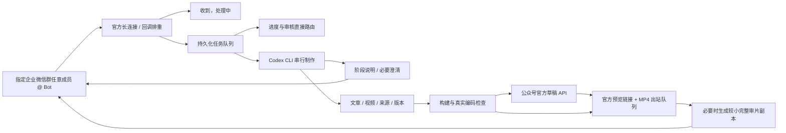

# 工作流与运维

## 代码位置

| 目录 | 内容 |
|---|---|
| `editorial/wecom-bot-local` | 官方 Bot、群绑定、任务队列、Codex app-server、即时控制、媒体压缩 |
| `editorial/wechat-content-studio` | 版本管理、Remotion/排版、草稿接口、审核、可选 TurboPush 本地库 |
| `wechat-editorial-workflow` | 全流程 Skill |
| `math-explainer-animation` | 数学 SVG 动画 Skill、模板和脚本 |
| `st-petersburg-math-documentary` | 人物纪录片 Skill、字幕及声音脚本 |
| `editorial/upstream/wechat-article-skills` | 固定版本的第三方排版与草稿构造辅助代码 |

## 运行状态

入站 `state/inbox/<msgid哈希>.json` 保存真实消息、发起人、排队和执行结果。任务按接收时间串行进入 Codex。会话 ID 保存在 `state/codex-thread.json`，后续任务续用；没有已有任务时不创建、发送稿件。重启遇到执行中的任务置 outcome_unknown，先核对本地 Codex 会话和实际产物，不自动重做。

制作中逐段转发用户可见的 assistant commentary，不转发推理或工具日志。需要用户选择时先问并结束本轮等待下一条回复；不会把整个任务先做完才提问题。原生 app-server 只转发 commentary，最终答复在 turn/completed 后发送。

运行中的普通消息调用 turn/steer，不等整轮结束；显式“停止”调用 turn/interrupt，“打断：新要求”中断后优先续做。“新任务：……”才排队。进度查询直接读取状态。原始消息、即时控制消息和 native turnId 相互关联；旧控制到达时若目标已结束，不能作用于下一条任务。主动停止不启用 exec fallback，不把取消当失败重跑。

工作室 `jobs/C编号/vN` 保存 brief、源文件、输出、manifest、QA、真实审核与 official API 回执。每个版本不可原地覆盖已送审文件，修改创建下一版本。`outbox/*.json` 保存目的地、文件 SHA256、发送步骤和回执，必须由发送器独占写入。

| 状态 | 含义与处理 |
|---|---|
| queued | 等待处理，不能当作已发出 |
| sending | 正在生成传输副本、上传或发送；不能在此时重启 |
| sent | 所有业务发送得到官方成功回执；仍需用户确认实际收到 |
| upload_failed | 准备或上传失败，尚未调用视频发送；可依据明确错误处理后由操作员重新入队，保留 text ACK |
| delivery_unknown | 发送结果不明；先查实际群消息，禁止自动重复发送 |
| outcome_unknown | Codex 执行或回复结果不明；先核对会话与任务再决定后续 |
| steered | 原生接口已接受当前任务的追加消息；结果跟随原任务返回 |
| interrupted | 当前原生 turn 已确认中断；保留已生成文件 |
| control_unknown | 即时控制结果不明，不自动重放控制或复制执行任务 |

上传初始化与上传分片不等于群内已发送。MP4 默认以 file 类型上传并发送为文件附件，保留 C编号-v版本.mp4 文件名。大于 9.5MiB 的视频仍生成单独传输副本，原始版本和清单不变；副本绑定原片 SHA256、完整解码，并抽帧到 delivery 子目录。业务发送成功后每一步立即落盘，文本成功而附件失败不重复文本。出站签名及文件去重包含媒体类型，旧视频消息回执不会冒充文件附件回执；修改默认格式不会自动补发历史任务。

出站内容关联 source_message_id。收到停止后，该任务尚未发送的关联内容取消；上传已经开始时可以完成临时素材上传，但在实际发视频前再核对取消状态，不把过时成品继续推送。已成功发出的消息和已完成的远端写入不会因停止而回滚。

## 公众号接口

只允许 token、draft/count/get/add、封面永久素材和正文图片等明确端点。SSL 校验开启，不跟随第三方跳转，不调用 freepublish/submit。草稿创建前记录 creating；网络断开保留 outcome_unknown，防止重复草稿。真正的 draft/get URL 才能作为官方预览；media_id、后台编辑地址或本地网页都不能替代。

未设置或错误凭证只影响需要该接口的任务，不在终端、群或 Git 中输出密钥。群审核只改变 review 状态，没有自动发布接口。

## Windows 实测与 Linux 移植

旧 Windows 实例曾完成公众号草稿、企业微信群文本及视频收发。约 19.4MB 的原生视频请求被拒，改为约 8.8MB、完整约178秒副本后上传和发送成功。这是设计传输副本与错误记录的来源，**不是本仓库 Linux 移植运行结果**。

按用户要求，本次未执行 Linux 安装、依赖运行、Codex 续会话、Remotion 渲染或真实群收发验证。源码测试入口及安装脚本仅随包提供，目标机器验收结果由用户完成。

## 第三方与发布

排版与草稿构造借助 Apache-2.0 上游子集，来源、固定提交和 LICENSE 随包提供。调用入口限制在工作室官方草稿封装，不直接调用上游公开发布命令。Remotion、React、SDK、Playwright、Sharp 等由依赖锁安装，其各自许可保持有效；部署使用者按各项目条款使用。

本包不含历史稿件、用户附件、账号凭证、Cookies、聊天、登录缓存、依赖二进制。发布或迁移现有任务是另一个操作，不能直接把当前工作机 state 整目录提交到仓库。
